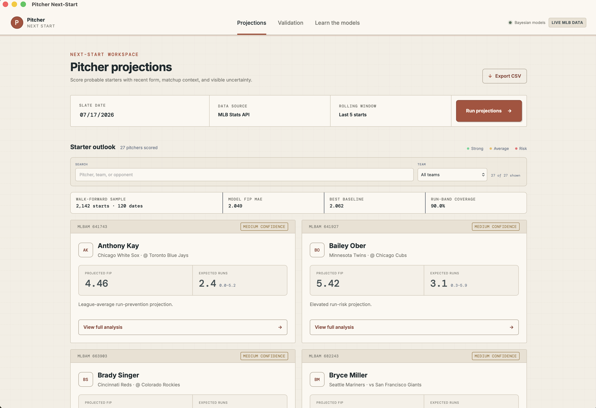
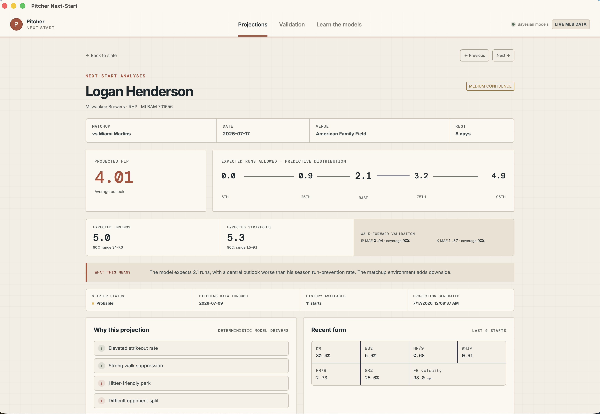

# Pitcher Next-Start

**A research-grade desktop app for predicting an MLB starting pitcher’s next outing.**

Pitcher Next-Start turns public MLB data into calibrated Bayesian projections for expected runs allowed, FIP, innings pitched, and strikeouts. Use the same projection as a player-prop research signal or an input to a larger team model.

Built with Rust, Tauri v2, and Svelte. No Python notebook and no R runtime in the application path.

[Project website](https://walrusquant.github.io/pitcher-next-start/) · [Model documentation](docs/learn.md)

## What it delivers

- Date-based scoring for probable MLB starters
- Four independent Bayesian linear models
- Posterior means and calibrated predictive intervals
- Expected runs, FIP, innings, and strikeout projections
- Leakage-safe, walk-forward validation against simple baselines
- Detailed player pages with recent form, workload, matchup context, and model drivers
- Prediction history with completed-start reconciliation
- CSV export and an in-app Learn section explaining the models

## Screenshots

| Main dashboard | Player projection |
|---|---|
|  |  |

> [!NOTE]
> This is a research model, not a betting guarantee. Projections express uncertainty and should be one input in a broader decision process.

## Positioning (read this first)

### Commitments
1. **Predictive first.** The product outputs a next-start projection, not a matchup recap.
2. **baseballr is the data contract.** Every required pull starts from a known `baseballr` function/surface, then gets reimplemented in Rust.
3. **One projection, two bet surfaces.** Same model output feeds player props and team-model expected-runs inputs.
4. **Agent-accelerated, not agent-magic.** Agents compress the pipeline work ~10x. They do not replace the model, the data contract, or judgment.
5. **Desktop product path.** Primary interface is a Tauri app, not a notebook or CLI theater.
6. **Learn the math.** In-app Learn section teaches the Bayesian model the way mlb-PE teaches Pythagorean — formulas, worked example, limits. Not a black box.

### What this is NOT
- Not a full sportsbook / bankroll platform
- Not DFS optimization
- Not “AI summary of tonight’s slate”
- Not a Python notebook that dies after the video
- Not a black-box score with no explanation
- Not a polished SaaS dashboard in Phase 1

## The Problem

Most AI sports-betting content is descriptive:
- matchup boards
- last-5 recaps
- chatbot summaries of public stats

That is not modeling.

A starting pitcher’s next start is a real recurring prediction problem:
- rotations are semi-structured
- recent form is measurable
- park, opponent, and rest matter
- the projection is useful both as a **prop input** and as a **team-model input**

The work is ugly and real:
1. find pbp / game-log data
2. clean it
3. model prep
4. build the model
5. test + calibrate
6. predict what comes next

That pipeline is where AI agents actually provide value.

## The Solution

Pitcher Next-Start is a **Rust + Tauri + Svelte** desktop app that:

1. Pulls MLB data through a **baseballr-compatible Rust data layer**
2. Builds next-start feature rows from recent form + context
3. Fits a **Bayesian linear regression** model from day one (candidate engine: [rustmc](https://tbosier.github.io/rustmc/))
4. Shows decision cards in-app:
   - projected next-start FIP (posterior mean)
   - expected runs allowed band (credible interval)
   - expected innings and strikeouts (independent Bayesian posterior means)
   - confidence (from posterior width / sample strength)
   - one-line judgment
   - optional prop lean
   - team-model input fields
5. Ships a **Learn** section (mlb-PE style) that walks through the Bayesian math: model form, priors, posterior → card fields, leakage rules, worked example, limits
6. Exports CSV for props / team-model handoff

### Stack (locked)
| Layer | Tech |
|---|---|
| Core pipeline | Rust library |
| Desktop shell | Tauri v2 |
| UI | Svelte |
| Data contract | baseballr → Rust |

Adam’s normal stack. Coding agents should follow global `AGENTS.md` / `CLAUDE.md` conventions for Tauri + Svelte layout and patterns.

### Architecture rule
```text
pns-core (Rust)  ->  Tauri commands  ->  Svelte UI
```
- Model logic lives in Rust core.
- Tauri is a thin IPC/native shell.
- Svelte renders results; it does not own modeling.
- Optional thin CLI can wrap the same core later. Not the Phase 1 primary path.

### 80/20 split
- **Automated:** ingest, clean, feature build, train/score, card export
- **Human:** target choice, model judgment, final betting decision, narrative

## Where Pitcher Next-Start Fits (and where it doesn’t)

| You want to… | Use | Not this |
|---|---|---|
| Predict one starter’s next outing | Pitcher Next-Start | Matchup recap threads |
| Feed K / ER / outs props | Projection card | “Ace vs bad lineup” vibes |
| Feed expected runs into a team model | Projection as input feature | Full game simulator (later) |
| Demo an AI-agent build workflow | This repo + AGENTS.md | Empty dashboard theater |
| Live odds shopping / CLV tracking | Later system | Not v1 |

**Wedge:** baseballr-faithful data contract, Rust implementation, desktop projection cards that are immediately usable for betting systems.

## Architecture

### Layers
1. **Data layer (Rust)** — baseballr-equivalent clients + normalization
2. **Feature layer (Rust)** — rolling form + next-start context
3. **Model layer (Rust)** — Bayesian linear regression (posterior mean + credible intervals)
4. **Decision layer (Rust)** — projection cards + CSV export
5. **App shell (Tauri + Svelte)** — date → run → cards → export + Learn
6. **Learn layer (Svelte content)** — static math walkthrough of Bayesian next-start model (source draft: `docs/learn.md`)
7. **Agent layer** — AGENTS.md + coding agents accelerate implementation

### Why this stack
- matches Adam’s current desktop product stack (Tauri + Svelte + Rust)
- converts baseballr workflows into durable Rust code
- video/demo shows a real app, not terminal-only output
- core stays reusable if a thin CLI is added later
- better long-term path than notebook demos

### Golden invariant
Normalized tables are the only model input.  
Raw API responses are fixtures/artifacts.  
`references/baseballr_map.md` is the data source-of-truth contract.

## Project Structure (On-Disk Format)

```text
pitcher-next-start/
  README.md
  techSpec.md
  PROJECT.md
  AGENTS.md
  docs/
    learn.md                 # Learn section source (Bayesian math walkthrough)
  src-tauri/                 # Tauri v2 app (Rust host)
    src/
      main.rs / lib.rs       # thin commands → core
  crates/
    pns-core/                # data / features / model / card
      src/
        data/
        features/
        model/
        card/
  src/                       # Svelte frontend (or app/ per global convention)
    routes/learn/            # in-app Learn page (ports docs/learn.md)
  data/
    raw/
    processed/
    fixtures/
  outputs/
    predictions.csv
    cards/
  references/
    baseballr_map.md
  tests/
```

Exact folder names may follow Adam’s global Tauri/Svelte conventions. Keep the split: **core library vs thin app shell**.

## Key Features

### v1 differentiators
- baseballr → Rust mapped data path
- next-start projection, not descriptive board
- dual-use output: prop lean + team-model input
- Bayesian linear model from day one (not frequentist-then-Bayesian)
- posterior-based confidence + credible bands
- **Learn** tab: in-app math walkthrough of the model (same product role as mlb-PE Learn)
- desktop app demo path: pick date → score → cards → CSV + open Learn

### Explicit later
- full slate automation
- live odds comparison
- rich dashboard / design polish
- deep pitch-quality / Stuff-style features
- hierarchical multi-season models
- optional thin CLI for headless batch

## Data Contract: baseballr → Rust

### Principle
`baseballr` defines **what** we pull and the shape we need.  
Rust implements **how** we pull it for the product/demo path.

### Conversion rule
For each required baseballr function:
1. document R call + output columns
2. identify underlying public endpoint/query
3. implement Rust client with comparable schema
4. lock fixtures/tests for required fields

### Runtime rule
- R may be used once for schema inspection
- demo/runtime path does **not** depend on R

## Build Phases

### Phase 0 — Contract spike
- inventory baseballr functions
- write `references/baseballr_map.md`
- confirm endpoint feasibility
- **Exit:** locked data contract

### Phase 1 — Rust core data path
- schedule + pitcher logs clients
- normalize tables
- fixtures + smoke tests
- **Exit:** rebuild last-N starts for 2 pitchers in Rust

### Phase 2 — Features
- rolling form features
- next-start context joins
- **Exit:** leakage-safe feature matrix

### Phase 3 — Model
- Bayesian linear regression train/score from day one
- posterior mean + credible intervals
- time-aware validation
- calibration / posterior predictive checks
- **Exit:** reproducible Bayesian projections from core

### Phase 4 — App shell + demo
- Tauri commands wrapping core
- minimal Svelte UI (date, run, cards, export, **Learn**)
- Learn page content from `docs/learn.md` (formulas + worked example + limits)
- CSV + card outputs
- **Exit:** app scores ≥2 starters, shows cards, and has a working Learn section

### Phase 5 — Optional polish
- nicer UI
- slate mode
- richer pbp features
- optional thin CLI for batch

## Business / Use Model

This is not a SaaS v1.
It is:
- a real modeling system Adam can reuse
- a public video proof that AI agents accelerate real sports-betting workflows
- a foundation for later team models / prop systems
- a desktop product shape that matches Adam’s other apps

## Competitive Reality

| Approach | Reality |
|---|---|
| Generic AI betting videos | High-level, low value |
| Public matchup boards | Descriptive, not predictive |
| Full betting platforms | Too big, wrong first wedge |
| Notebook-only models | Die after demo |
| CLI-only demo | Works for nerds; weaker product story |
| **This** | Small predictive loop + reusable Rust core + desktop app shell |

## Current implementation

The Phase 1 live vertical slice is implemented: date-specific MLB probable starters, live pitcher game logs normalized in Rust, leakage-safe rolling features, conjugate Bayesian linear regression, credible run bands, decision cards, CSV/Markdown export, thin Tauri v2 commands, and a Svelte UI with the required Learn page. Tests remain deterministic through committed MLB-shaped fixtures.

Run the checks and desktop app:

```sh
cargo test --workspace
pnpm check
pnpm tauri dev
```

Generate deterministic fixture-backed sample artifacts without launching the UI:

```sh
cargo run -p pns-core --example generate_sample -- 2026-07-16
```

Score and export a real historical MLB slate:

```sh
cargo run -p pns-core --example score_live -- 2025-07-12
```

Rebuild the processed multi-season training dataset:

```sh
cargo run -p pns-core --example build_dataset -- 2023 2024 2025
cargo run -p pns-core --example enrich_dataset
```

The live model uses the processed 2023–2025 history when available and adds roughly 400 days of prior regular-season starts for the probable pitchers on the selected slate. Features are standardized from training data. Historical opponent and park factors are calculated chronologically from only earlier dates and shrunk toward the prior league rate. Four-seam/sinker velocity is aggregated from Baseball Savant by pitcher-start date. Future-slate opponent strength uses league-relative team OPS versus the starter's hand, while park environment uses the home club's home/away runs-per-game ratio. Walk-forward validation reports model and baseline MAE, raw interval coverage, and empirically calibrated interval coverage in `outputs/validation.json`.

The desktop build embeds the normalized training dataset so scoring does not depend on the repository working directory. MLB responses use bounded retries plus TTL-based disk caching. Scored live projections are recorded under the application-data directory and can be reconciled with completed MLB game logs from the Validation page.

This is still a research model, not a betting guarantee. The current park estimate is a season environment proxy rather than a multi-year weather-adjusted park model, and the prior/feature specification needs evaluation across additional seasons.

## One-line promise

**Convert a baseballr-style pitcher workflow into a Rust-core Tauri app, predict the next start, and turn that projection into a prop lean or team-model input.**
